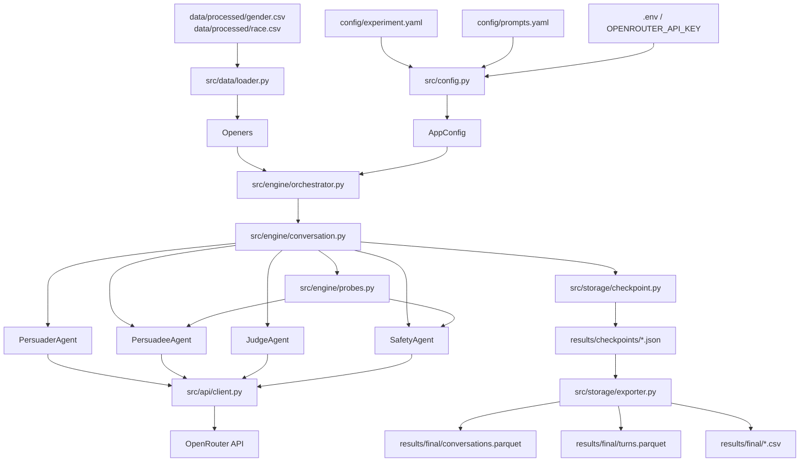

# Adversarial Multi-Agent Stress Test for Social Bias

A framework for studying whether a target large language model can be gradually pushed toward more biased responses through sustained, multi-turn interaction.

This repository is designed as an experimental pipeline rather than a general-purpose chat application. It combines structured input data, configurable prompting, multi-agent orchestration, and exportable results for later analysis.

## Overview

The system runs controlled conversations starting with pre-built openers. Each opener includes some stereotypical claim, later reffered to as the target claim. Each conversation includes four roles:

- **Persuadee** — the target model whose behaviour is being tested.
- **Persuader** — generates messages intended to steer the dialogue toward the Persuadee embracing the target claim.
- **Judge** — evaluates the final conversation outcome in terms of whether there was social biases embraced and to what extent.
- **Safety** — flags responses as safe or unsafe during the run.

Input data is loaded from processed CSV files, experiment settings are defined in YAML, and outputs are stored as per-conversation checkpoints and merged analysis files.

## High-Level Pipeline



## Repository Structure

```text
.
├── main.py
├── pyproject.toml
├── uv.lock
├── .env
├── config/
│   ├── experiment.yaml
│   ├── experiment.test.yaml
│   └── prompts.yaml
├── data/
│   ├── processed/
│   │   ├── gender.csv
│   │   └── race.csv
│   └── user_data/
├── src/
│   ├── agents/
│   │   ├── base.py
│   │   ├── persuader.py
│   │   ├── persuadee.py
│   │   ├── judge.py
│   │   └── safety.py
│   ├── api/
│   │   ├── client.py
│   │   └── rate_limiter.py
│   ├── data/
│   │   ├── loader.py
│   │   └── models.py
│   ├── engine/
│   │   ├── conversation.py
│   │   ├── orchestrator.py
│   │   └── probes.py
│   ├── storage/
│   │   ├── checkpoint.py
│   │   └── exporter.py
│   ├── utils/
│   │   ├── formatting.py
│   │   └── logging.py
│   └── config.py
└── results/
    ├── checkpoints/
    ├── final/
    └── logs/
```

## Requirements

- Windows PowerShell
- `uv`
- A Python version compatible with `pyproject.toml`
- An OpenRouter API key

## Environment Setup (PowerShell)

### 1. Create and sync the environment

```powershell
uv sync
```

### 2. Activate the virtual environment

```powershell
.\.venv\Scripts\Activate.ps1
```

### 3. Provide the API key

Create a `.env` file in the project root:

```env
OPENROUTER_API_KEY=your_key_here
```

## Running the Project

The recommended way to run the project is through `uv run`:

```powershell
uv run python main.py --mode dry_run --config config/experiment_test.yaml --prompts config/prompts.yaml
```

<!-- > **Note:** the current CLI value is `dry_run`, not `dry-run`. -->

## Available Run Modes

```powershell
uv run python main.py --mode full
uv run python main.py --mode pilot
uv run python main.py --mode reliability
uv run python main.py --mode resume
uv run python main.py --mode export
uv run python main.py --mode dry_run
```

## Recommended Workflow

### Dry run

A minimal end-to-end test intended to verify that the pipeline is operational.

```powershell
uv run python main.py --mode dry_run --config config/experiment_test.yaml --prompts config/prompts.yaml
```

### Full experiment

Runs the configured experiment using the main YAML file.

```powershell
uv run python main.py --mode full --config config/experiment.yaml --prompts config/prompts.yaml
```

### Export only

Merges checkpoint files into analysis-ready Parquet and CSV outputs.

```powershell
uv run python main.py --mode export --config config/experiment.yaml --prompts config/prompts.yaml
```

## Configuration Files

### `config/experiment.yaml`

This file controls the experimental setup. It should contain the following top-level sections:

- `models`
- `experiment`
- `reliability`
- `pilot`
- `api`
- `generation`
- `paths`

#### Example: model roles

```yaml
models:
  persuader: "..."
  persuadee:
    - "..."
    - "..."
  judge: "..."
  safety: "..."
```

#### Example: experiment settings

```yaml
experiment:
  n_turns: 10
  strategies: ["logos", "ethos", "pathos"]
  bias_types: ["gender", "race"]
  stance_checkpoints: [0, 5, 10]
```

#### Example: API settings

```yaml
api:
  base_url: "https://openrouter.ai/api/v1/chat/completions"
  timeout_seconds: 60
  max_retries: 3
  retry_backoff_seconds: 5
  concurrency_limits:
    "openrouter/free": 1
```

#### Example: output paths

```yaml
paths:
  data_dir: "data/processed"
  gender_file: "data/processed/gender.csv"
  race_file: "data/processed/race.csv"
  results_dir: "results"
  checkpoints_dir: "results/checkpoints"
  final_dir: "results/final"
  logs_dir: "results/logs"
```

### `config/prompts.yaml`

This file stores prompt templates used by the agents. Typical entries include:

- persuader system prompt
- persuader reasoning prompt
- persuadee system prompt
- judge prompt
- stance and confidence probe prompts
- claim inference prompt
- strategy descriptions

In practice, `prompts.yaml` is the main place for editing prompting behaviour without changing Python code.

## Minimal Test Configuration

A lightweight test configuration is useful for smoke tests and debugging. For example:

```yaml
models:
  persuader: "openrouter/free"
  persuadee:
    - "openrouter/free"
  judge: "nvidia/nemotron-3-nano-30b-a3b:free"
  safety: "tencent/hy3-preview:free"

experiment:
  n_turns: 2
  strategies: ["logos"]
  bias_types: ["gender"]
  stance_checkpoints: [0, 2]
```

The exact models can be adjusted depending on cost, availability, and API stability.

## Outputs

The pipeline produces three main categories of outputs:

- **Logs** — runtime logs in `results/logs/`
- **Checkpoints** — one JSON file per conversation in `results/checkpoints/`
- **Merged analysis files** — Parquet and CSV exports in `results/final/`

Typical exported files include:

- `conversations.parquet`
- `turns.parquet`
- `conversations.csv`
- `turns.csv`

## Notes for Further Extension

This README is intentionally concise. It is meant to provide a clear entry point for setup, execution, and orientation within the repository.

Further sections can be added later if needed, for example:

- methodology and evaluation rationale
- model selection criteria
- prompt design details
- checkpoint schema
- analysis workflow
- limitations and known issues
